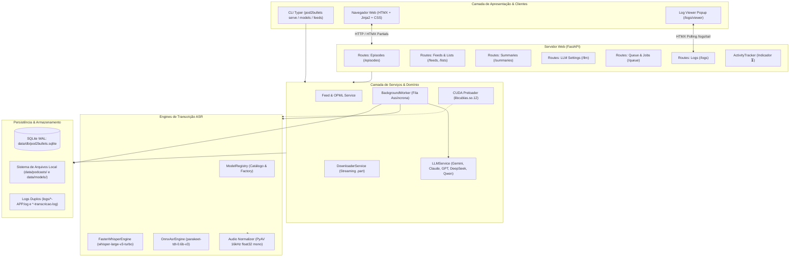
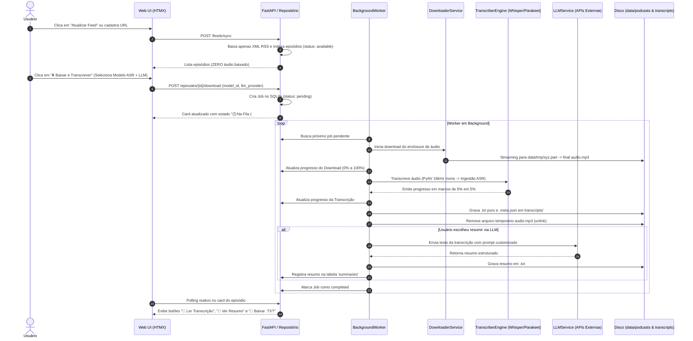
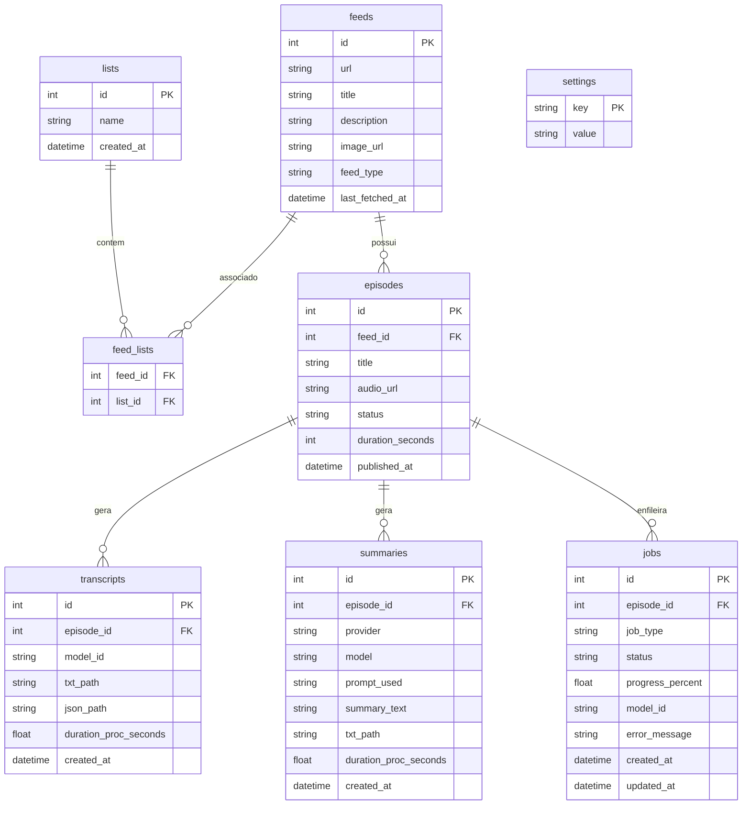

# Arquitetura do Sistema (`pod2bullets`)

Este documento descreve detalhadamente a arquitetura de software, decisões de design, modelos de dados e fluxos de execução do **`pod2bullets`**.

---

## 1. Visão Geral e Princípios Arquiteturais

O `pod2bullets` é um sistema web e CLI projetado para rodar inteiramente no ambiente **WSL (`Ubuntu-26.04`)**, com aceleração por GPU NVIDIA (CUDA 12) e fallback para CPU. Ele permite gerenciar subscrições de podcasts, baixar áudios sob demanda, transcrever localmente via modelos SOTA de IA e gerar resumos inteligentes por LLMs.

### Pilares de Design
1. **Privacidade e Autonomia Total:** A transcrição ASR é 100% local. Áudios nunca saem da máquina do usuário.
2. **Zero Download Automático de Áudio:** O consumo de banda só ocorre por ordem explícita do usuário para episódios individuais.
3. **Eficiência de Disco:** O arquivo de áudio (`.mp3`, `.m4a`) é automaticamente descartado pós-transcrição, mantendo apenas o texto puro (`.txt`) e metadados (`.meta.json`).
4. **Resiliência e Concorrência:** O banco de dados SQLite opera em modo **WAL (Write-Ahead Logging)** com timeout estendido (`busy_timeout=30000`), permitindo leituras concorrentes pela interface web enquanto o worker processa jobs pesados em background.
5. **Simplicidade Operacional:** Interface reativa construída com **FastAPI + Jinja2 + HTMX**, dispensando etapas de compilação de JavaScript ou dependências em Node.js.

---

## 2. Diagrama Geral de Componentes

---

## 3. Fluxo de Processamento de Ponta a Ponta

O diagrama de sequência a seguir ilustra o ciclo completo de um episódio: da sincronização do feed ao resumo final.

---

## 4. Modelo de Dados Relacional (SQLite WAL)

O banco de dados é estruturado em SQLite com chaves estrangeiras ativas e índices em colunas de alta consulta.

---

## 5. Subsistemas Críticos em Detalhe

### 5.1. Normalização de Áudio com PyAV (`audio.py`)
Podcasts utilizam uma variedade enorme de codecs e containers (`.mp3`, `.m4a`, `.aac`, `.opus`, `.ogg`, `.wav`).
Em vez de depender de um binário do `ffmpeg` instalado no sistema operacional do host:
- A biblioteca `av` (`PyAV`) decodifica o fluxo de áudio diretamente em memória.
- O reamostrador (`AudioResampler`) converte os frames para taxa de amostragem de **16.000 Hz, 1 canal (mono) e formato `fltp` (float32)**.
- O resultado é um array NumPy unidimensional pronto para ingestão direta pelos tensores dos modelos Whisper ou Parakeet.

### 5.2. Preloader de CUDA 12 (`cuda_env.py`)
No WSL com Python 3.14 e bibliotecas instaladas via wheel (como `nvidia-cublas-cu12` e `nvidia-cudnn-cu12`), bibliotecas nativas de C++ não são automaticamente descobertas pelo `ctranslate2` sem prévia configuração:
- `ensure_cuda_libraries_loaded()` inspeciona os diretórios `.venv/lib/python3.14/site-packages/nvidia/*/lib` e `/usr/lib/wsl/lib`.
- Configura a variável `LD_LIBRARY_PATH`.
- Executa chamadas `ctypes.CDLL(..., mode=ctypes.RTLD_GLOBAL)` para as bibliotecas `libcudart.so.12`, `libcublasLt.so.12`, `libcublas.so.12` e `libcudnn*.so.9`.
- Se necessário, efetua um auto-reexec do processo para que o linker dinâmico do Linux reconheça os novos paths antes da inicialização do CTranslate2.

### 5.3. Gerenciamento de Filas e Throttling (`queue.py`)
- O `BackgroundWorker` opera em uma thread dedicada no mesmo processo do FastAPI.
- Ele faz polling na tabela `jobs` a cada segundo quando ocioso.
- Durante o processamento de áudio ou transcrição, atualizações de progresso para a tabela `jobs` sofrem **throttling** (máximo de uma gravação a cada 0.5s ou a cada marco de 5%), eliminando contention no banco SQLite.
- O cancelamento de jobs interrompe o fluxo imediatamente, encerra subprocessos/loops de inferência e limpa arquivos residuais `.part`.

### 5.4. Integração Multi-LLM Resiliente (`llm/service.py`)
- Suporta 5 provedores líderes: **Google Gemini**, **Anthropic Claude**, **OpenAI ChatGPT**, **DeepSeek** e **Alibaba Qwen**.
- **Descoberta Dinâmica de Modelos:** Em caso de erro `404 / Model Not Found` ou obsolescência de modelos, o serviço consulta dinamicamente a rota `/models` do provedor para eleger o modelo equivalente mais moderno.
- **Histórico Transparente de Tentativas:** Registra cada tentativa (`Tentativa 1/3`, `Tentativa 2/3`) no log da aplicação sem lançar stack traces alarmantes na interface.
- **Coexistência de Múltiplos Resumos:** O usuário pode gerar um resumo com Gemini e outro com Claude para o mesmo episódio. O repositório armazena todos na tabela `summaries` com seus respectivos caminhos `.txt`, permitindo comparação visual na tela `/summaries`.

### 5.5. Arquitetura de Logging Duplo (`logging_config.py`)
O sistema divide automaticamente a telemetria em dois fluxos persistentes em disco na pasta `logs/`:
1. `YYYY-MM-DD-HH-MM-APP.log`: Registra requisições da web, inicializações de serviços, sync de RSS, downloads e erros gerais.
2. `YYYY-MM-DD-HH-MM-transcricao.log`: Registra exclusivamente eventos de inferência ASR, checkpoints de 5% em 5%, troca de modelos e resumos LLM.
3. `/logs/viewer`: Endpoint HTML com HTMX polling que renderiza os logs em uma janela popup com tema escuro e visualização em tempo real.

---

## 6. Registro de Decisões Arquiteturais (ADRs)

| Decisão | Escolha | Motivo |
| :--- | :--- | :--- |
| **ADR-001** | Zero download automático de áudio | Feeds de podcasts acumulam dezenas de GBs de dados. Baixar apenas metadados protege a banda e o disco do usuário. |
| **ADR-002** | Exclusão do MP3 pós-transcrição | Podcasts são efêmeros após transcritos. Manter apenas o `.txt` e `.meta.json` reduz o consumo de disco em mais de 98%. O botão "Reprocessar Tudo" permite baixar novamente se necessário. |
| **ADR-003** | HTMX + Jinja2 em vez de SPA (React/Vue) | Elimina a necessidade de ambiente Node.js, `npm`, bundlers (Vite/Webpack) e complexidade de autenticação por tokens, mantendo a aplicação 100% Python e rápida. |
| **ADR-004** | SQLite WAL com timeout de 30s | Dispensou a instalação de um servidor pesado de banco de dados (como PostgreSQL), preservando portabilidade máxima sem riscos de bloqueio (`sqlite3.OperationalError: database is locked`). |
| **ADR-005** | PyAV para normalização de áudio | O usuário não precisa rodar `apt-get install ffmpeg` nem depender de codecs globais da distribuição Linux. O PyAV empacota o libav em C dentro do wheel Python. |
